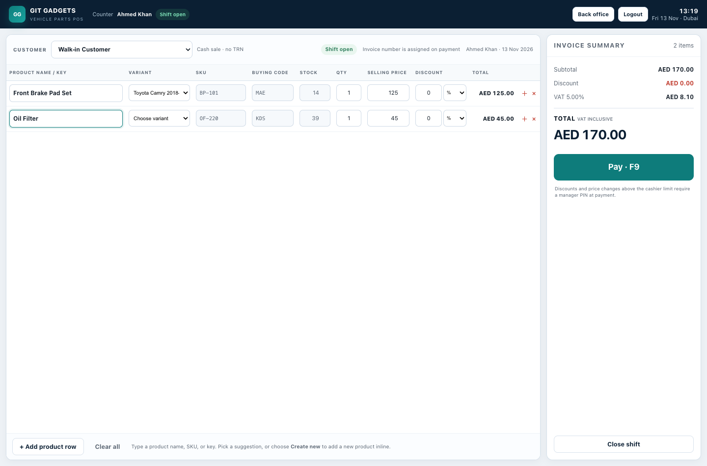
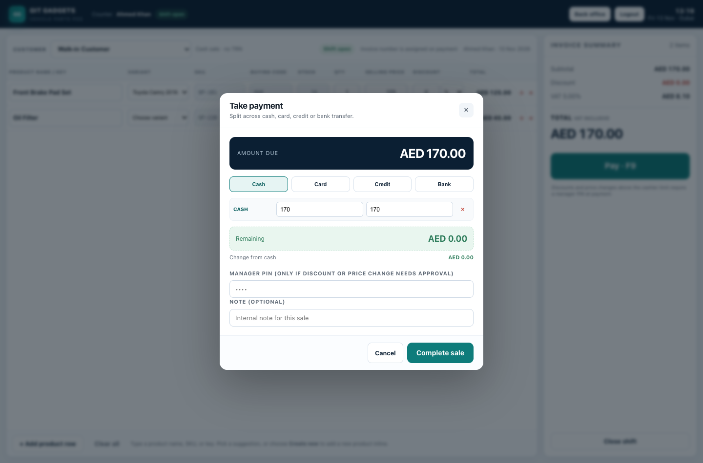
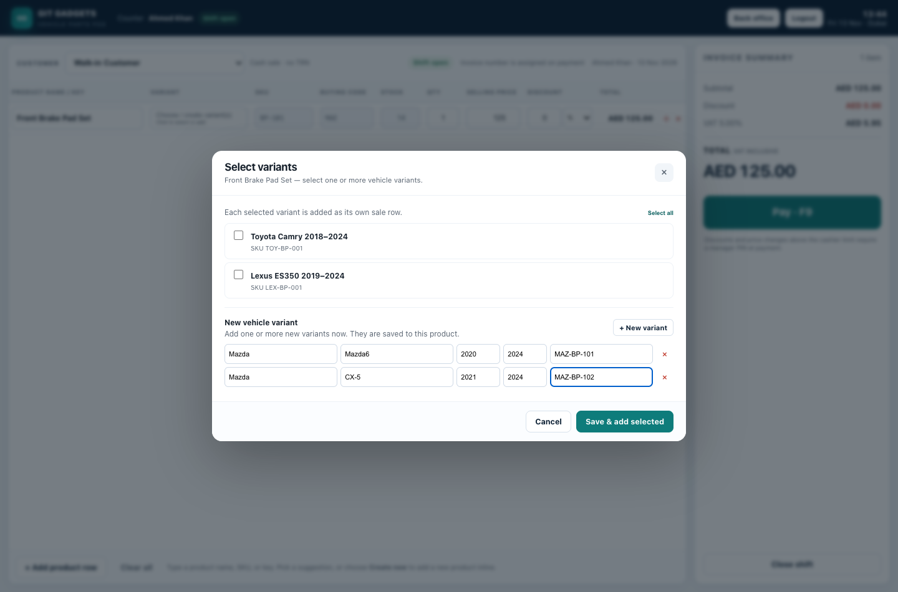
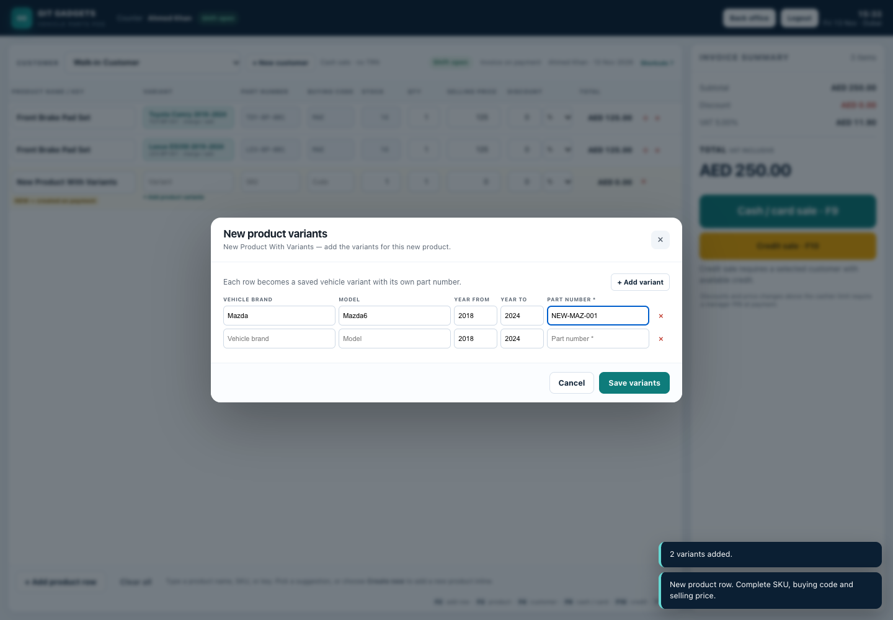
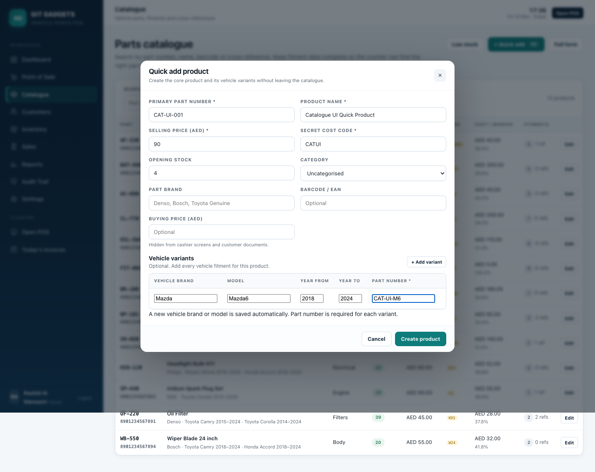
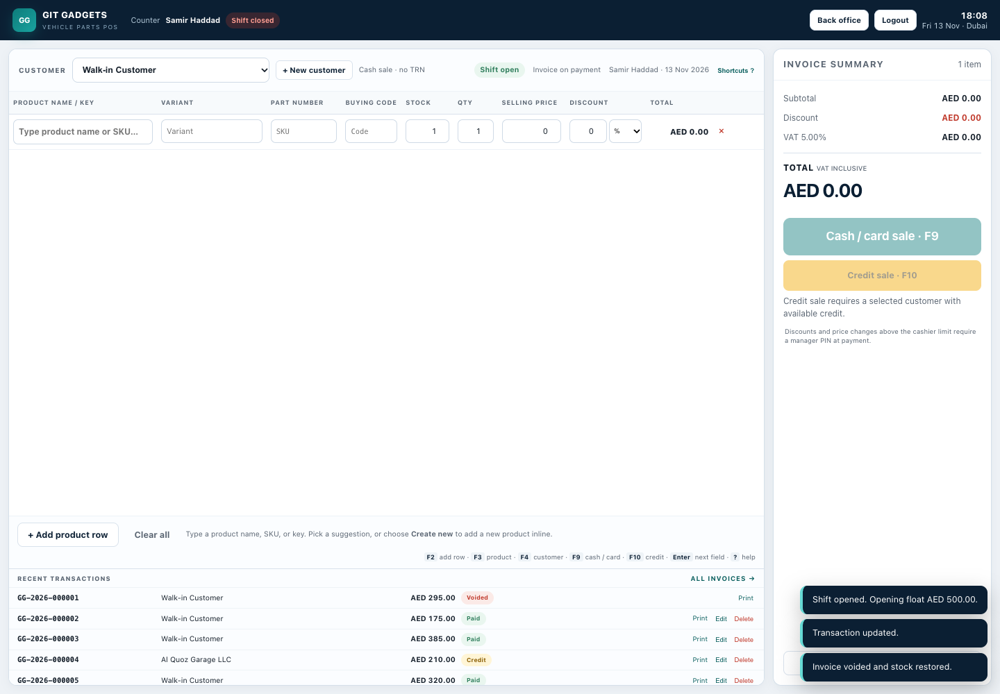
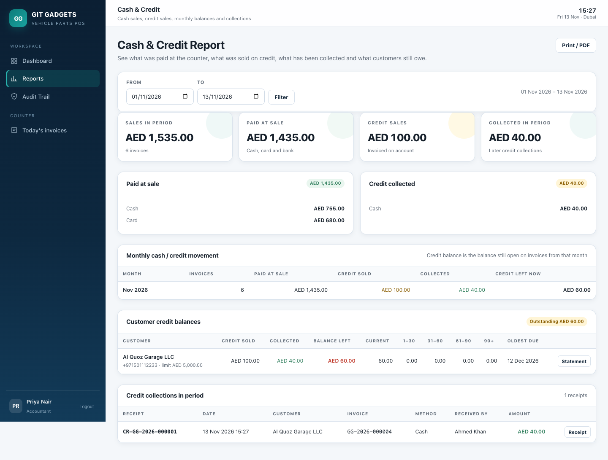
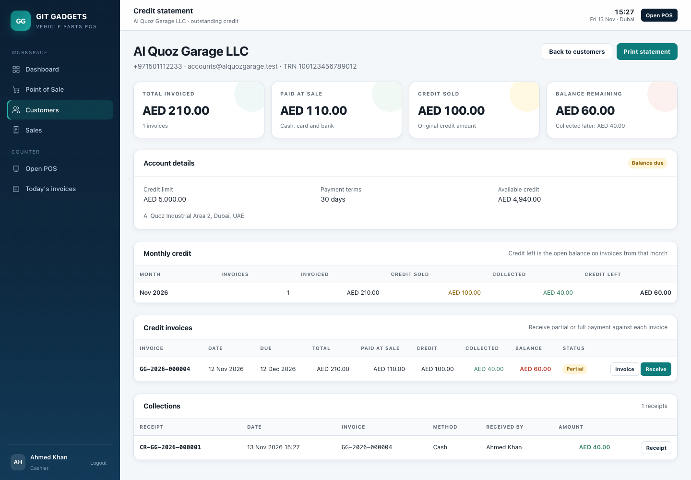

# dubai_pos

**Git Gadgets POS** — a Laravel 12 point-of-sale application for a Dubai vehicle spare-parts counter.

It is built around the two things a parts shop needs at the counter: **fitment-first search** and **hiding the real purchase cost from the customer**.



## What is included

- **Fitment-first catalogue** — one product, many vehicle fitments and OEM/cross-reference numbers. Search by part number, vehicle, year, cross-reference, name, or barcode.
- **Secret cost code** — a manually entered code shown to counter staff. The numeric cost is permission-gated and never sent to a cashier's API response or printed on customer documents.
- **Inline product creation** — when a product is not in the catalogue, create it from the sale row with SKU, secret buying code, selling price and opening stock. Vehicle variants can be selected in the row; the **＋** action duplicates the product for another variant.
- **Catalogue quick add** — press **F2** on the catalogue page to open a compact product form with pricing, secret code, opening stock and multi-row vehicle variants, without leaving the list.
- **Table POS** — customer selection, walk-in default, **new-customer creation from the POS**, product search, a click-to-select variant picker that can add several existing variants or create multiple new vehicle variants at once, **a variant builder for new products**, separate **cash/card and credit sale actions**, inline new-product rows, quantity, line discounts, price override with a reason, split payments and cash change.
- **Variant part numbers & stock** — every vehicle variant carries its own part number and independent stock quantity. The POS shows and decrements the selected variant stock; Inventory has a variant-stock control and the stock ledger records the variant movement. Variant stock never inherits or borrows from the product total or other variants. Blank means not counted, with zero available to sell. Products without variants use one product stock balance. The SKU column, invoice and receipt use the selected variant part number while retaining the parent product number.
- **Variant buying price** — each new variant can carry a masked buying price. The value is stored on the variant and used for COGS; it is never shown in the sale table or on customer documents.
- **Hidden buying price** — owners and managers can enter a masked buying price for a new product from the row lock action. It is stored as the numeric cost and never displayed in the table or on customer documents.
- **Keyboard-first** — F2 add row, F3 product search, F4 new customer, F9 cash/card payment, F10 credit sale, **Enter to move to the next field**, and `?` for the shortcut reference.
- **Recent transactions** — the lower POS strip shows the latest invoices with Print, Edit (customer/vehicle/note) and Delete (void + stock restore, manager PIN for cashiers).
- **Approval controls** — discounts above the cashier limit and price overrides require a manager PIN (`1234` in the demo).
- **UAE VAT invoices** — 5% VAT, VAT-inclusive or VAT-exclusive pricing, sequential `GG-2026-000001` invoice numbers, 80 mm receipt and A4 tax invoice.
- **Stock ledger** — every sale, receipt, return, adjustment and opening quantity is written to an append-only movement history. Weighted-average cost on receipt.
- **Returns & credit notes** — partial returns, restock decision, VAT reversal and a printable credit note linked to the original invoice.
- **Customers & credit** — company TRNs, credit limits, outstanding balances; credit sales are blocked above limit. Customers get a printable credit statement, monthly credit view, aging and a **receipt for every partial or full collection**.
- **Shifts & cash** — opening float, cash/card split, expected cash, blind close, variance, Z-style shift close.
- **Reports** — sales, daily summary, **cash vs credit**, monthly credit movement, customer aging, VAT, gross profit by part and inventory valuation.
- **Roles** — owner, manager, cashier, storekeeper and accountant. Cost and profit views are restricted.
- **Audit trail** — sales, discounts, returns, stock changes, settings and logins are recorded.

## Screens

| Dashboard | Table POS | Catalogue |
|---|---|---|
|  |  |  |

| Tax invoice | VAT report | Payment |
|---|---|---|
|  |  |  |

**Variant picker** — select several existing variants or create multiple new ones at once:



**New product variant builder** — add vehicle variants while creating a new product from the POS:



**Catalogue quick add** — press F2 to create a product and its variants from the catalogue:



**Recent transactions** — lower POS strip with print, edit and void actions:



**Cash & credit report** — counter sales, credit sales, collections and customer balances:



**Customer credit statement** — monthly credit, invoice balances and collection action:



## Demo accounts

All demo accounts use the password **`password`**. Manager approval PIN is **`1234`**.

| Role | Email | PIN |
|---|---|---|
| Owner | `owner@gitgadgets.test` | `9999` |
| Manager | `manager@gitgadgets.test` | `1234` |
| Cashier | `cashier@gitgadgets.test` | `1111` |
| Storekeeper | `store@gitgadgets.test` | `2222` |
| Accountant | `accounts@gitgadgets.test` | `3333` |

The seeder creates a cashier shift with AED 500 float and six sample invoices, so the dashboard and reports are populated on first run.

## Run it

Requirements: PHP 8.2+, Composer, SQLite (bundled with PHP) or MySQL.

```bash
cd dubai_pos
composer install
cp .env.example .env
php artisan key:generate
php artisan migrate --seed
php artisan serve
```

Open <http://127.0.0.1:8000> and sign in with the cashier account. No Node/Vite build is required; the UI uses plain CSS and vanilla JavaScript in `public/`.

To reset the demo data:

```bash
php artisan migrate:fresh --seed
```

### MySQL instead of SQLite

Change `.env`:

```dotenv
DB_CONNECTION=mysql
DB_HOST=127.0.0.1
DB_PORT=3306
DB_DATABASE=git_gadgets_pos
DB_USERNAME=root
DB_PASSWORD=
```

Then run `php artisan migrate --seed`.

## Tests

```bash
php artisan test
```

The suite covers VAT-inclusive/exclusive calculations, invoice discounts, split-payment sales, stock decrementing, cost visibility, manager approval, Quick Add, invoice privacy, credit notes/restocking, and role restrictions.

Current result: **35 tests passing** (including VAT, split payments, table POS, discounts, multi-variant product creation, variant snapshots, returns and cost-privacy checks).

## Key project files

```text
app/
├── Http/Controllers/
│   ├── PosController.php             POS screen
│   ├── Api/PosApiController.php      search, quick add, holds, sale, shift
│   ├── DashboardController.php       KPIs and recent sales
│   ├── ProductController.php         catalogue + fitments + cross-refs
│   ├── InventoryController.php       stock in / adjustment / ledger
│   ├── SaleController.php            invoices, returns, credit notes
│   ├── ReportController.php          sales / VAT / profit / stock
│   └── ...
├── Models/                           Product, Sale, SaleReturn, Shift, ...
├── Services/
│   ├── PricingService.php            integer-fils VAT and discount engine
│   ├── SaleService.php               one transaction for money + stock
│   ├── ApprovalService.php           manager PIN approval
│   ├── ReturnService.php             credit notes + restocking
│   ├── StockService.php              weighted-average receipts and ledger
│   ├── ShiftService.php              expected cash and variance
│   └── SearchService.php             vehicle / part / cross-ref search
└── Support/                          Money, Pos settings, invoice numbers
database/
├── migrations/                       POS schema
└── seeders/DatabaseSeeder.php        demo catalogue, users and sales
public/
├── css/app.css                       application and print styles
└── js/pos.js                         POS state, cart, payment and modals
```

## Design notes

- **Money is calculated server-side in integer fils.** The browser totals are a convenience; the server recalculates every sale and rejects a mismatch.
- **Stock is a ledger.** `products.stock_qty` is the current cached balance; `stock_movements` is the audit history.
- **The secret code is not encryption.** It protects against casual shoulder-surfing, not a determined insider. Rotate codes when staff leave and use a privacy filter.
- **Full tax invoice by default.** The UAE is tightening invoice rules as e-invoicing is phased in. A full tax invoice is the default; a simplified template is not enabled in this MVP.
- **Local-first.** The app is designed to run on a shop server; no internet dependency is required for the counter. SQLite is used for easy demo; MySQL is recommended for production.
- **PCI scope reduction.** Card payments are recorded as a method and reference only. The app never accepts or stores card numbers; use the bank's terminal.

## Not in this MVP

- Purchase orders / supplier invoice matching (stock receipt and weighted-average cost are included).
- Full offline PWA with sync.
- Peppol / UAE e-invoicing XML transmission.
- Accounting package integration.
- Multi-branch transfers.
- PDF generation server-side; use the browser's **Print / Save PDF** on the A4 invoice.
- Card processing integration.

These are the natural Phase 2 items from the accompanying documentation.

## Demo limitation

This is a working MVP, not the final production deployment. Before going live:

1. Change all demo passwords and PINs.
2. Set the real legal name, TRN, address and invoice footer in **Settings**.
3. Confirm VAT invoice details and full-vs-simplified treatment with the tax agent.
4. Move to MySQL, configure a nightly encrypted backup, and test a restore.
5. Put the app behind HTTPS and restrict the back office to the shop network/VPN.
6. Load the real catalogue, fitments and opening stock.

## Invoice format and customer vehicles

The A4 invoice uses the reference layout with a blue customer/details panel, item tax columns, total amount in words and a Received by signature line. Company information comes from Settings. Credit collections and remaining balances are retained.

Customers can save an optional car plate number. At the POS, the invoice plate pre-fills from the customer and can be changed or cleared. A separate optional Person / Driver field identifies the visitor acting for a company. The company remains the billing customer. Both fields are saved on the sale; blank fields do not print. Updating customer details does not rewrite invoice snapshots.

After deploying, run `php artisan config:clear`, `php artisan migrate --force`, `php artisan config:cache`, and `php artisan view:cache`. On this cPanel account use `/opt/cpanel/ea-php82/root/usr/bin/php` in place of `php`. Back up the database first; do not use migrate:fresh.

### Independent variant stock deployment

Each variant must have its own counted stock. Existing blank variant quantities are intentionally not copied from the old combined quantity, because that would duplicate inventory. Enter the actual quantities under Inventory > Variant stock. The parent quantity is only a cached reporting rollup; variant sales validate and change the selected SKU only. Product search returns no parent stock quantity for a product with variants. Catalogue and inventory list each variant quantity separately.

Run `php artisan migrate --force` after this update to add per-variant ledger balances. Older movements without a recorded variant balance show a dash, rather than a misleading combined balance. Do not re-run the demo seeder on an existing shop database.

Validation: `php artisan test` and `node --test tests/JavaScript/variant-stock.test.cjs`.

### Optional part numbers

Product and variant part numbers are optional in catalogue forms and POS creation. Multiple products may have a null part number. Existing part numbers retain uniqueness checks. Variants without part numbers are selected by their saved variant ID, so their stock stays independent. Run migrations after deployment to make the product part-number column nullable.
