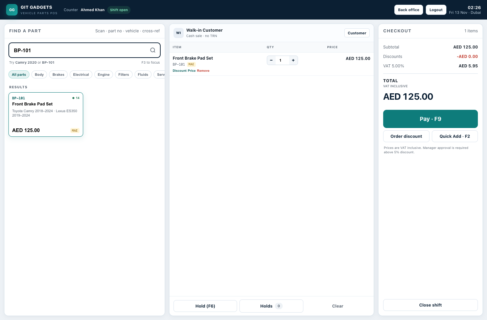
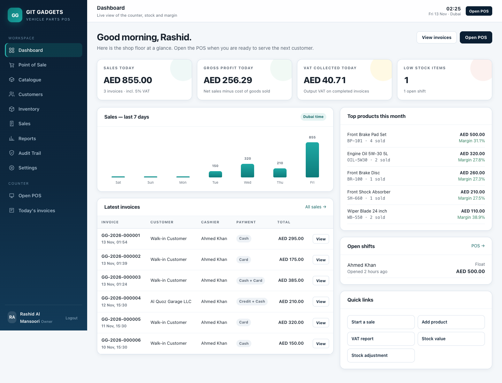
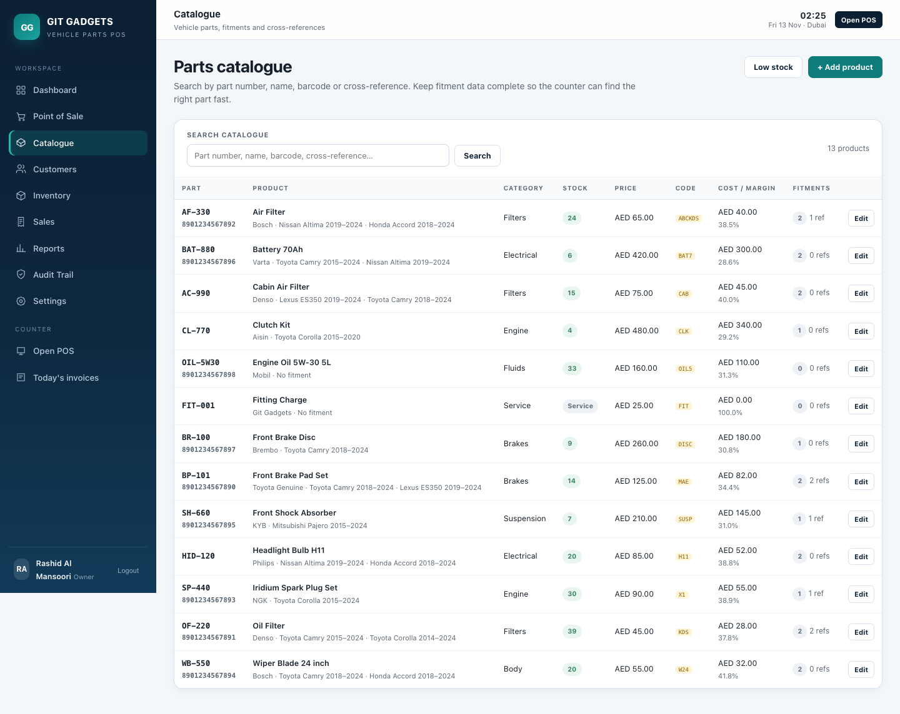
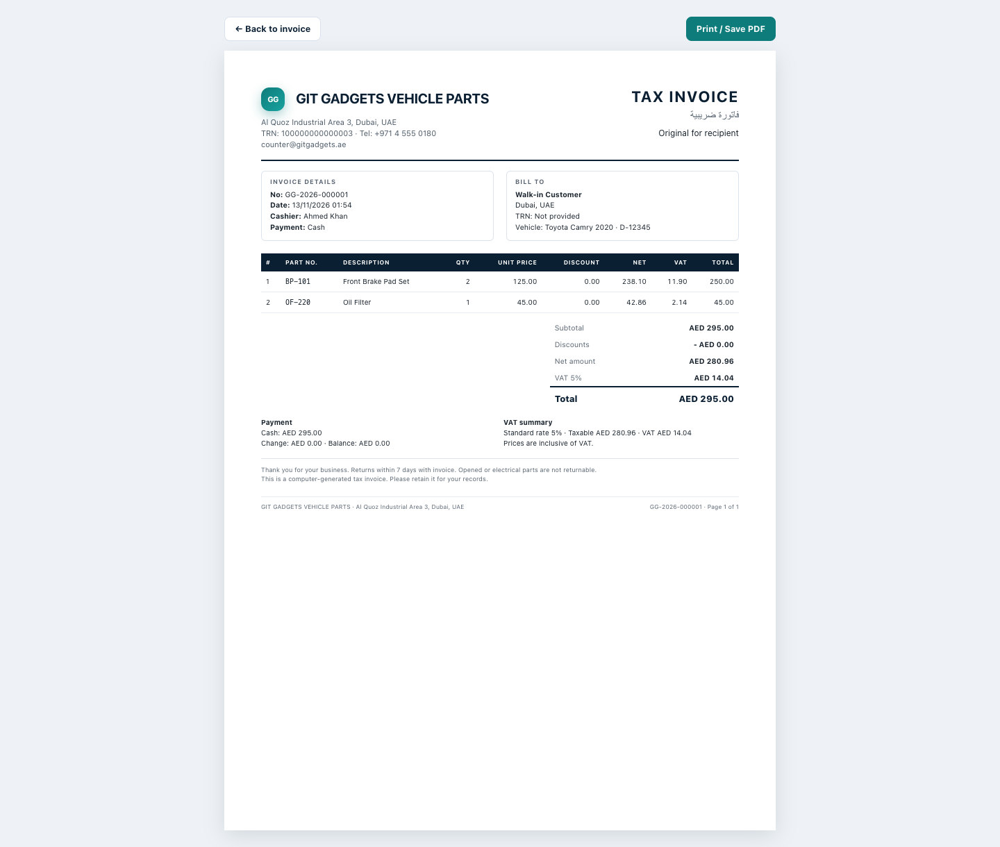
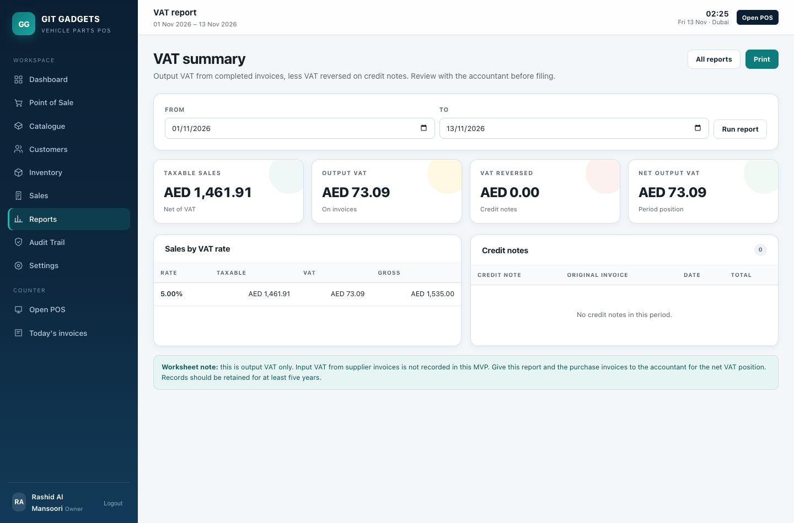
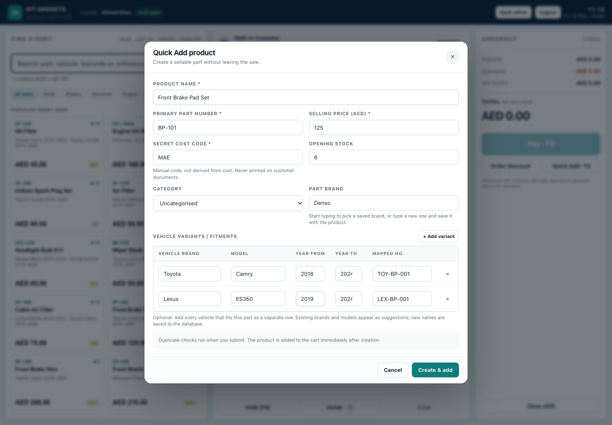

# dubai_pos

**Git Gadgets POS** — a Laravel 12 point-of-sale application for a Dubai vehicle spare-parts counter.

It is built around the two things a parts shop needs at the counter: **fitment-first search** and **hiding the real purchase cost from the customer**.



## What is included

- **Fitment-first catalogue** — one product, many vehicle fitments and OEM/cross-reference numbers. Search by part number, vehicle, year, cross-reference, name, or barcode.
- **Secret cost code** — a manually entered code shown to counter staff. The numeric cost is permission-gated and never sent to a cashier's API response or printed on customer documents.
- **Quick Add** — create a product, multiple vehicle variants in one table, price, secret code and opening stock without leaving the sale. Part brands and vehicle brands/models have saved suggestions; a new name is written to the database when you save.
- **POS cart** — quantities, line discounts, order discounts, price override with a reason, hold/resume, split cash/card/credit/bank payments and cash change.
- **Approval controls** — discounts above the cashier limit and price overrides require a manager PIN (`1234` in the demo).
- **UAE VAT invoices** — 5% VAT, VAT-inclusive or VAT-exclusive pricing, sequential `GG-2026-000001` invoice numbers, 80 mm receipt and A4 tax invoice.
- **Stock ledger** — every sale, receipt, return, adjustment and opening quantity is written to an append-only movement history. Weighted-average cost on receipt.
- **Returns & credit notes** — partial returns, restock decision, VAT reversal and a printable credit note linked to the original invoice.
- **Customers & credit** — company TRNs, credit limits, outstanding balances; credit sales are blocked above limit.
- **Shifts & cash** — opening float, cash/card split, expected cash, blind close, variance, Z-style shift close.
- **Reports** — sales, daily summary, VAT, gross profit by part and inventory valuation.
- **Roles** — owner, manager, cashier, storekeeper and accountant. Cost and profit views are restricted.
- **Audit trail** — sales, discounts, returns, stock changes, settings and logins are recorded.

## Screens

| Dashboard | POS | Catalogue |
|---|---|---|
|  |  |  |

| Tax invoice | VAT report | Quick Add |
|---|---|---|
|  |  |  |

## Demo accounts

All demo accounts use the password **`password`**. Manager approval PIN is **`1234`**.

| Role | Email | PIN |
|---|---|---|
| Owner | `owner@gitgadgets.test` | `9999` |
| Manager | `manager@gitgadgets.test` | `1234` |
| Cashier | `cashier@gitgadgets.test` | `1111` |
| Storekeeper | `store@gitgadgets.test` | `2222` |
| Accountant | `accounts@gitgadgets.test` | `3333` |

The seeder creates a cashier shift with AED 500 float and six sample invoices, so the dashboard and reports are populated on first run.

## Run it

Requirements: PHP 8.2+, Composer, SQLite (bundled with PHP) or MySQL.

```bash
cd git-gadgets-pos
composer install
cp .env.example .env
php artisan key:generate
php artisan migrate --seed
php artisan serve
```

Open <http://127.0.0.1:8000> and sign in with the cashier account. No Node/Vite build is required; the UI uses plain CSS and vanilla JavaScript in `public/`.

To reset the demo data:

```bash
php artisan migrate:fresh --seed
```

### MySQL instead of SQLite

Change `.env`:

```dotenv
DB_CONNECTION=mysql
DB_HOST=127.0.0.1
DB_PORT=3306
DB_DATABASE=git_gadgets_pos
DB_USERNAME=root
DB_PASSWORD=
```

Then run `php artisan migrate --seed`.

## Tests

```bash
php artisan test
```

The suite covers VAT-inclusive/exclusive calculations, invoice discounts, split-payment sales, stock decrementing, cost visibility, manager approval, Quick Add, invoice privacy, credit notes/restocking, and role restrictions.

Current result: **19 tests passing** (including VAT, split payments, discounts, multi-variant Quick Add, product form variants, returns and cost-privacy checks).

## Key project files

```text
app/
├── Http/Controllers/
│   ├── PosController.php             POS screen
│   ├── Api/PosApiController.php      search, quick add, holds, sale, shift
│   ├── DashboardController.php       KPIs and recent sales
│   ├── ProductController.php         catalogue + fitments + cross-refs
│   ├── InventoryController.php       stock in / adjustment / ledger
│   ├── SaleController.php            invoices, returns, credit notes
│   ├── ReportController.php          sales / VAT / profit / stock
│   └── ...
├── Models/                           Product, Sale, SaleReturn, Shift, ...
├── Services/
│   ├── PricingService.php            integer-fils VAT and discount engine
│   ├── SaleService.php               one transaction for money + stock
│   ├── ApprovalService.php           manager PIN approval
│   ├── ReturnService.php             credit notes + restocking
│   ├── StockService.php              weighted-average receipts and ledger
│   ├── ShiftService.php              expected cash and variance
│   └── SearchService.php             vehicle / part / cross-ref search
└── Support/                          Money, Pos settings, invoice numbers
database/
├── migrations/                       POS schema
└── seeders/DatabaseSeeder.php        demo catalogue, users and sales
public/
├── css/app.css                       application and print styles
└── js/pos.js                         POS state, cart, payment and modals
```

## Design notes

- **Money is calculated server-side in integer fils.** The browser totals are a convenience; the server recalculates every sale and rejects a mismatch.
- **Stock is a ledger.** `products.stock_qty` is the current cached balance; `stock_movements` is the audit history.
- **The secret code is not encryption.** It protects against casual shoulder-surfing, not a determined insider. Rotate codes when staff leave and use a privacy filter.
- **Full tax invoice by default.** The UAE is tightening invoice rules as e-invoicing is phased in. A full tax invoice is the default; a simplified template is not enabled in this MVP.
- **Local-first.** The app is designed to run on a shop server; no internet dependency is required for the counter. SQLite is used for easy demo; MySQL is recommended for production.
- **PCI scope reduction.** Card payments are recorded as a method and reference only. The app never accepts or stores card numbers; use the bank's terminal.

## Not in this MVP

- Purchase orders / supplier invoice matching (stock receipt and weighted-average cost are included).
- Full offline PWA with sync.
- Peppol / UAE e-invoicing XML transmission.
- Accounting package integration.
- Multi-branch transfers.
- PDF generation server-side; use the browser's **Print / Save PDF** on the A4 invoice.
- Card processing integration.

These are the natural Phase 2 items from the accompanying documentation.

## Demo limitation

This is a working MVP, not the final production deployment. Before going live:

1. Change all demo passwords and PINs.
2. Set the real legal name, TRN, address and invoice footer in **Settings**.
3. Confirm VAT invoice details and full-vs-simplified treatment with the tax agent.
4. Move to MySQL, configure a nightly encrypted backup, and test a restore.
5. Put the app behind HTTPS and restrict the back office to the shop network/VPN.
6. Load the real catalogue, fitments and opening stock.
